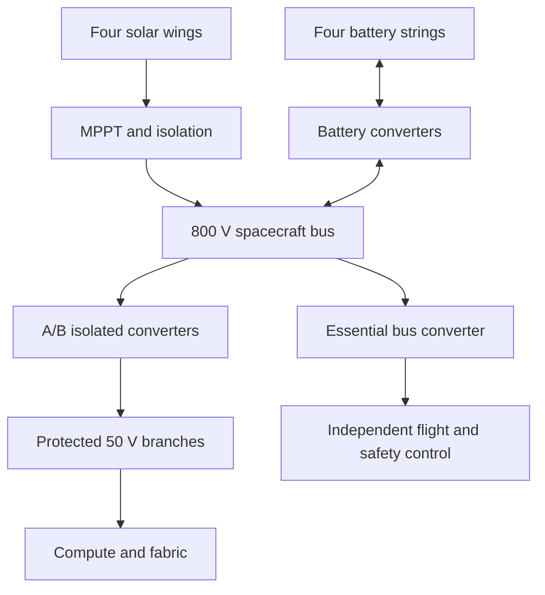
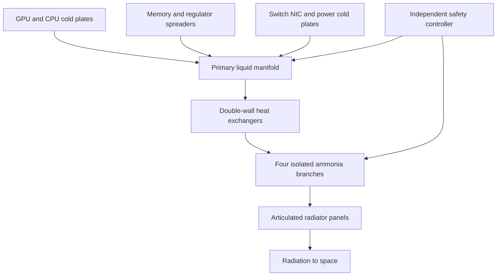

# System architecture

## Mission and computing payload

Preserve a supported local GB200-class topology: 72 GPUs and 36 Grace CPUs, conceptually 18 compute trays with four GPUs/two CPUs each and nine NVLink switch trays. The rendered rack also includes eight protected distribution cassettes and two network/management shelves: 37 tray/shelf allocations in total. These shapes are interface envelopes, not PCB layouts or production CAD.

The assembly is custom and fully cold-plated. A commercial terrestrial cabinet is not assumed to operate after its fans are removed. Retain a 1.2 × 1.5 × 2.5 m / 2,000 kg assembly allocation until suppliers define boards, cooling, restraints, power and firmware. Short supported copper NVLink paths constrain repackaging. Scattering GPUs over solar/radiator panels is not a valid substitute for an electrically qualified fabric.

The surrounding Ø3.5 m external, 6 m-long bay is a vented frame with removable debris/radiation panels. Baffled vent paths avoid trapped ascent pressure. The bay is not a pressure vessel; sealed liquid loops, accumulators, batteries and propulsion tanks still need their own containment and pressure qualification.

## Electrical paths

Two 150 kW conversion trains are independently isolatable; redundancy requires actual fault analysis. Eight local branches divide approximately 2,400 A of compute current. Short busbars and controlled returns replace a long aggregate low-voltage harness. Precharge, startup sequencing, fast overcurrent protection, telemetry and chassis bonding must follow supported hardware interfaces.

Disable unqualified high-voltage operation through ascent/venting. Vacuum insulation, low-pressure arcing and LEO plasma interactions are separate design concerns. Batteries have independent monitoring, thermal control, isolation and vent provisions; no fault propagation behavior is assumed from the energy budget.

## Thermal paths

Two 100 kW primary heat-exchanger modules operate in parallel with redundant pump heads/check valves. Two exchangers at 100 kW each do not imply full-power operation after loss of one exchanger. Double walls and monitored interspaces reduce cross-contamination risk. External ammonia stays outside the inner electronics shield.

Every dissipating part needs a verified path: GPU/CPU plates, memory/VRM spreaders, cold-backed trays, switch/NIC plates, storage enclosures, converter bases and battery/service decks. Liquid never contacts exposed electronics in this design; it circulates through sealed channels. No air convection is credited.

Use flooded forced-flow loops, degassed fill, accumulators and gas separators. Microgravity does not provide a natural gravity return. At low load, bypass or isolate radiator sections while controlling cold-end temperature. A branch may only drain into an accumulator if forced/capillary transfer has been engineered; gravity drain-back is unavailable. Otherwise demonstrate freeze/thaw survivability with trapped-fluid expansion accommodated.

## Mechanical geometry and deployment

| Assembly | Baseline allocation |
|---|---|
| Core bay | Ø3.2 m clear / Ø3.5 m external × 6.0 m |
| Compute package | 1.2 × 1.5 × 2.5 m |
| Four solar blankets | 5.5 × 50 m each |
| Solar stowage cassettes | 5.5 × 0.8 × 0.8 m each |
| Four radiator wings | 5 × 35 m each |
| Radiator modules | 56 panels, 5 × 2.5 m |
| Four radiator packs | 5 × 2.5 × 1.0 m each, two deck layers |
| Launch envelope allocation | Ø7.4 × 10.5 m |
| Final deployed plan span | approximately 110 × 86 m |

The primary load path runs through the adapter, frame and restrained compute cradle. Blankets and shielding panels do not carry launch interface loads. Flexible fluid lines have restrained bend radii and pressure-qualified joints through 13 inter-panel hinge positions per wing; root articulation adds further hose-routing demands.

Deployment sequence: separate and stabilize; verify essential power, attitude, venting and coolant inventory; move radiator packs clear on root arms; extend/latch panel chains; enable low-flow thermal circulation; rotate solar cassettes and roll out blankets; establish optical and independent recovery links; progressively energize compute after thermal/electrical commissioning. Intermediate poses and latch failures require simulation and gravity-offload testing.

Solar wings occupy approximately |Y| ≤6.75 m in the shown plan while radiator chains start at |Y| =8 m. The shown radiator width is vertical, z = −0.9 to 4.1 m, edge-on to the illustrative +Z Sun. This is one pose, not a continuously feasible orbit attitude solution.

## Attitude, propulsion and flexible dynamics

Allocate dual star trackers, GNSS, gyros and a radiation-tolerant controller; four 250 N·m·s-class control-moment units, magnetorquers and thruster unloading are sizing placeholders. A 100 m flexible spacecraft needs a coupled structural/control analysis. Neither the moment-of-inertia tensor nor jitter transfer functions have been calculated.

At 4.56 μPa, a conservative 1,800 m² projected area has about 0.0082 N incident radiation force before reflection. A 1 m offset gives approximately 0.0082 N·m and 47.5 N·m·s per 96.54-minute orbit. Symmetry helps but does not establish momentum balance. Aerodynamic torque, shadow transitions, cable motion, gimbal motion and slosh remain unresolved.

Concept D allocates four gridded-ion heads in diagonal pairs (two active, two spare), using a historical 6.9 kW / 0.237 N / 4,190 s prototype reference per head. Full pair spacecraft input is 15.28 kW after assumed PPU/front-end losses and controls; a 105 kW compute cap during burns preserves the 138 kW nominal envelope. The 500 kg xenon allocation is retained; a separate chemical system reserves 2,200 kg at 230 s Isp. See [the ion study](ION-PROPULSION.md). Public Starlink use of argon does not establish that its propulsion hardware fits this much larger platform. Tank geometry in the model is illustrative; propellant density, pressurant, residuals, materials, engine selection and burn duration are not defined.

## Communications and data handling

Use two proposed provider-approved Starlink Mini Laser terminals, counting one active 25 Gb/s-class link. The second supports acquisition/handover/redundancy subject to the actual service interface. Delete the earlier high-rate direct-Earth telescopes and Ka dish. Retain independent low-rate S-band command/telemetry on the essential bus so loss of precise optical pointing need not make the vehicle unreachable.

Illustrative folded mounts place deployed optical apertures near (0, ±3.2, 4.86) m. These housings are not supplier CAD. Position above the nominal radiator edge improves upper-hemisphere clearance but does not provide all-sky visibility. Actual peer trajectories, gimbal travel, Sun exclusion, Earth limb, self-masking, plume exclusions and optical-bench jitter determine service opportunities.

Keep 1 PB usable cache, a 400 GbE-class gateway allocation, resumable transfers, object checksums, authenticated commands and GPU checkpoints. The gateway port rate is not an end-to-end service rate. Keep tightly coupled GPU traffic within the local NVLink domain; the relay does not make separate satellites one NVL72 fabric.

## Autonomous operating modes

| Trigger | Intended response | Limit to verify |
|---|---|---|
| Startup / commissioning | Essential bus, thermal checks, staged workload ramp | No full load before radiator/pump verification |
| Ordinary science/compute | Schedule jobs inside power, thermal, cache and service limits | Per-device temperature and workload peaks |
| Electric propulsion burn | Cap compute input at 105 kW | Attitude, optical pointing and power transients |
| One radiator wing lost | Isolate; provisional 100 kW compute cap | Approximately 10% thermal reserve under baseline environment |
| One solar wing lost | Throttle below energy-only ceiling (~105 kW) | Recharge limit and eclipse season |
| One battery string lost | Throttle before long eclipse | ~112 kW energy-only ceiling; add operating reserve |
| Pump/flow loss | Block work and trip affected power promptly | Trip latency and thermal inertia measured in hardware |
| Both optical links lost | Continue only cache-bounded jobs; S-band recovery | Free storage, future connectivity, essential-bus endurance |
| Radiation errors/latch-up | Checkpoint, reset or isolate protected branches | Permanent damage and silent errors remain possible |
| Safe mode | Compute off, ≤8 kW essential target, warm bypass/freeze protection | Cold survival and independent command access |

These are control requirements, not a flight software implementation. Protection must remain independent of an unresponsive GPU operating system.

## Passive heat-transport alternative

[The passive thermal study](PASSIVE-THERMAL.md) evaluates heat pipes, loop heat pipes and capillary-pumped loops. The separate passive model view illustrates evaporation, vapor transport, condensation and wick-driven liquid return. It is not installed baseline hardware. Retain the pumped cold-plate baseline until heat flux, capillary/permeability limits, long flexible lines, startup and freeze protection are demonstrated. A hybrid with passive local spreading is the first development candidate.
